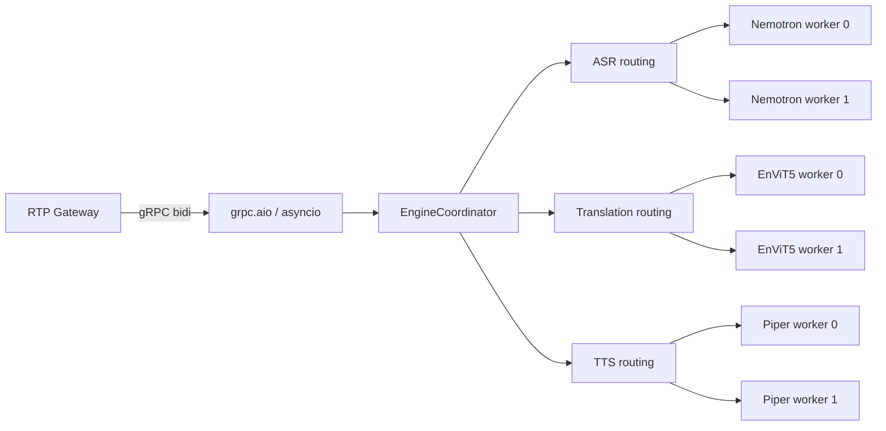
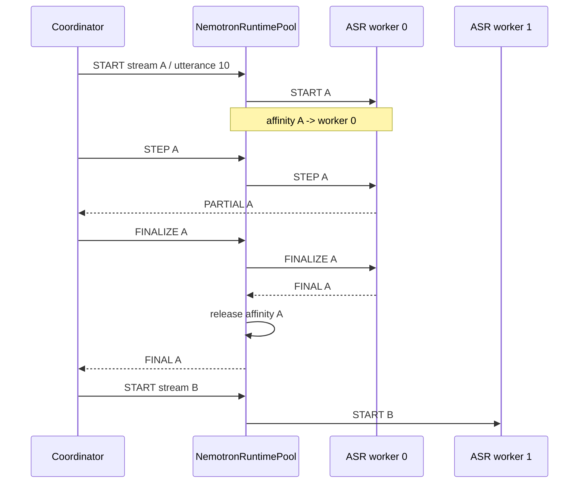
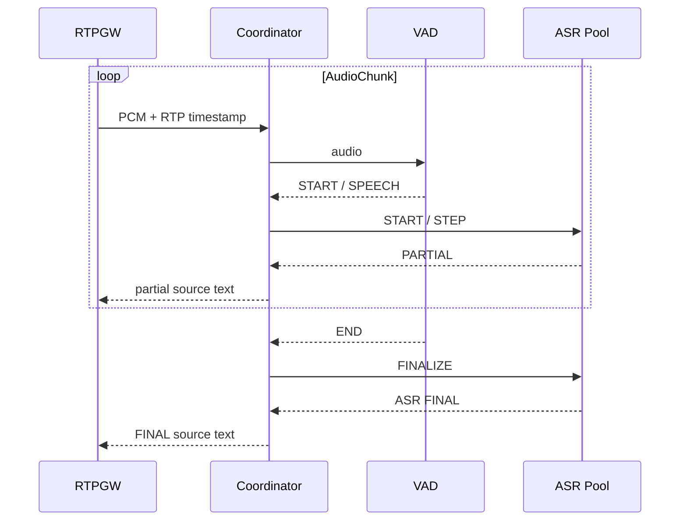
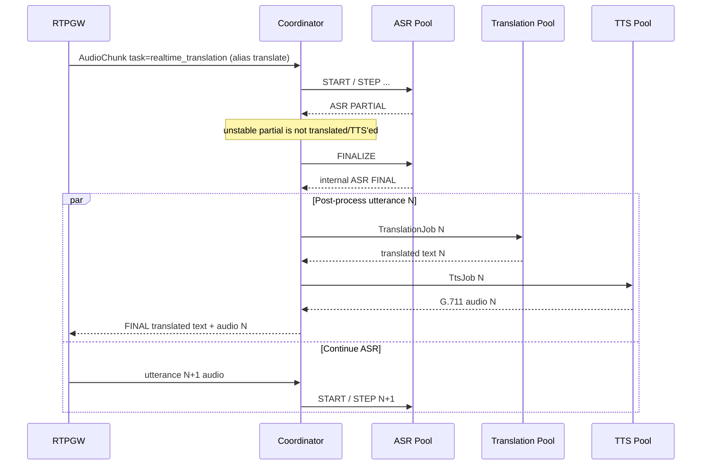

# Architecture — revised runtime pools

Mô hình và pipeline theo từng task (`speech_to_text`, `realtime_translation`): xem [models-and-pipeline.md](models-and-pipeline.md).
Thiết kế đầy đủ (module, pipeline, cấu hình, triển khai): xem [system-design.md](system-design.md).

## 1. Ownership model



Defaults use one worker in each stage. Pools are enabled by configuration, not by
changing the gRPC server implementation.

No gRPC coroutine calls Nemotron, CTranslate2, or Piper directly.

## 2. Stateful ASR pool

Nemotron streaming is stateful. A worker owns both a model replica and the
encoder/RNNT cache for every active stream assigned to it.



A stream is never allowed to send `STEP` to a different worker from the worker
that handled its `START`. Affinity ends only after `FINAL` or `CANCELLED`.

Each ASR worker loads a full Nemotron model replica. `ASR_WORKERS>1` therefore
increases RAM/VRAM usage substantially.

## 3. Transcribe sequence



`task=speech_to_text` (proto alias `transcribe`) stops after Nemotron. Translation and TTS are not involved.

## 4. Translate + TTS sequence



The ASR utterance is released immediately after Nemotron FINAL. Translation and
TTS continue in the background, so utterance N+1 does not wait for Piper of
utterance N.

## 5. Translation pool

Translation jobs are final-utterance jobs and do not carry streaming model
cache. Any worker may process any job.

Each worker owns its own CTranslate2 `Translator` and tokenizer instance. This
avoids concurrent calls into one shared model object.

## 6. TTS pool

Each TTS worker owns independent English and Vietnamese Piper voice instances
(`tts.backend: piper`), or one multilingual Magpie model (`tts.backend: magpie`).
Any final translated utterance may be sent to any available TTS worker.

With `segmentation.mode: on`, translation and TTS jobs are per sentence segment
rather than per utterance; ordering is then keyed by `(utterance_id, segment_idx)`.
See section 7 of [system-design.md](system-design.md).

The coordinator preserves output order per logical stream:

```text
utterance 10 -> emit first
utterance 11 -> emit second
utterance 12 -> emit third
```

Even if TTS 11 finishes before TTS 10, result 11 waits until result 10 is
committed.

## 7. Runtime identity

All model commands/jobs preserve:

```text
rpc_id
session_id
stream_id
utterance_id
```

Late results are discarded when their RPC or pipeline job is no longer active.

## 8. RPC completion

The response side remains alive until:

```text
input_closed == true
AND active logical streams == 0
AND pending translation/TTS jobs == 0
```

This allows translated audio to be returned after the client has already called
`CloseSend()`.

## 9. Logging

JSON logs go to stdout and, when configured, a daily-rotating file (local midnight, suffix `.YYYY-MM-DD`):

```text
LOG_FILE=/app/logs/nemotron-engine.log
LOG_BACKUP_COUNT=10        # days kept
```

Mount `/app/logs` to persistent storage if file logs must survive Pod/container
replacement.

Per-stage pipeline trace (`ASR_FINAL` → `TRANSLATE` → `TTS_PHRASE` → `EMIT`, plus
`DEGRADE` on every fallback to text-only) is controlled by `logging.pipeline_trace`
and `logging.pipeline_trace_text`. See [pipeline-trace-guide.md](pipeline-trace-guide.md)
for the field reference and `scripts/trace_stream.py`.

## 10. Capacity rule

Start at:

```text
ASR_WORKERS=1
TRANSLATION_WORKERS=1
TTS_WORKERS=1
```

Scale the measured bottleneck one stage at a time. Worker count multiplies model
instances and can also multiply native compute threads, so more workers do not
automatically mean more throughput.
