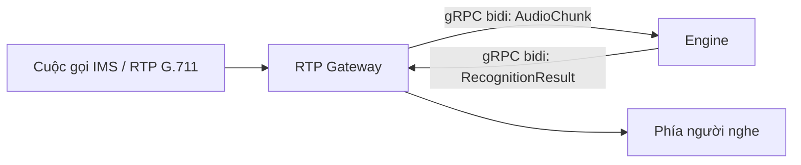
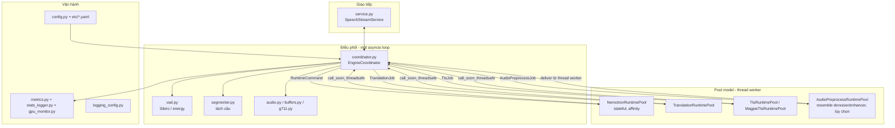
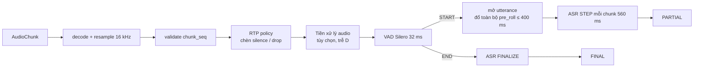
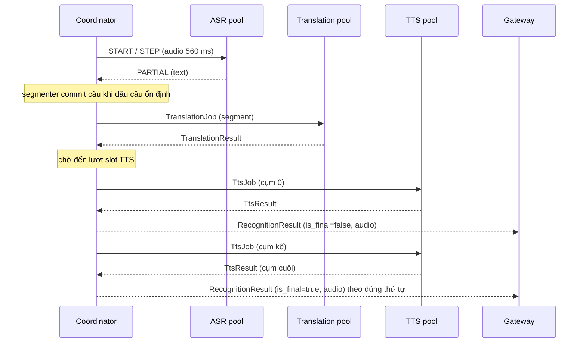

# Tài liệu thiết kế hệ thống — Nemotron Translate TTS Engine v0.3.3

Tài liệu mô tả kiến trúc, thiết kế module, chức năng từng module, luồng sản phẩm, pipeline và công nghệ của engine.
Tài liệu liên quan:

- [ARCHITECTURE.md](ARCHITECTURE.md): sơ đồ ownership và sequence của các pool.
- [models-and-pipeline.md](models-and-pipeline.md): mô hình và pipeline theo từng task.
- [pipeline-trace-guide.md](pipeline-trace-guide.md): đọc log trace pipeline.
- [telecom_realtime_utterance_segmentation_design.md](telecom_realtime_utterance_segmentation_design.md): thiết kế tách câu.

Mọi mô tả trong tài liệu dựa trên việc đọc code và cấu hình, chưa kiểm chứng trên môi trường chạy thật. Các mục 1 đến 8 đã được đối chiếu với mã nguồn ngày 2026-10-13 và sửa theo kết quả đối chiếu; không có test hay lần chạy nào được thực hiện trong đợt này. Hằng số và giá trị cấu hình lấy từ `etc/nemotron-engine.yaml` (cấu hình GPU production); bản triển khai thật có thể khác.

## 1. Mục tiêu và phạm vi

Engine là một dịch vụ gRPC streaming hai chiều, chạy trong hệ thống IMS (điện thoại). Nó nhận audio cuộc gọi theo thời gian thực từ RTP gateway và phục vụ hai task:

| Task | Chức năng | Đầu ra |
|---|---|---|
| `speech_to_text` | Nhận dạng giọng nói streaming | Text partial và final |
| `realtime_translation` | Nhận dạng, dịch vi↔en, đọc lại bằng giọng tổng hợp | Text đã dịch kèm audio G.711 |

Ngoài phạm vi: đóng gói và định tuyến RTP (do gateway làm), chuyển đổi giọng nói giữa nhiều ngôn ngữ ngoài vi/en, huấn luyện mô hình.

## 2. Luồng sản phẩm

### 2.1 Bối cảnh triển khai



- Gateway gửi `AudioChunk` PCM16 mono 16 kHz, mỗi chunk 80 ms (2560 byte, 1280 mẫu), kèm `rtp_timestamp` và `rtp_clock_rate` (8000, nên +640 tick mỗi chunk).
- Một cuộc gọi tương ứng một `session_id`; một session có thể có nhiều stream (`stream_id`, ví dụ `call-001-tcore`). Một RPC `Recognize` có thể mang nhiều stream.
- Với `realtime_translation`, trường `language` là ngôn ngữ **đích**; ngôn ngữ nguồn do ASR tự nhận, trừ khi gateway gửi `language_source` (`vi`/`en`) và `asr.use_language_source` đang bật thì dùng giá trị đó làm nguồn cố định.
- Engine trả `RecognitionResult` gồm `text`, `is_final`, `ts_start`/`ts_end` (tick RTP), `confidence`, `language`, `seq`, `audio_payload` và `audio_pt` (0 = PCMU, 8 = PCMA, 8 kHz).

### 2.2 Vòng đời một cuộc gọi dịch

1. Gateway mở RPC `Recognize` và gửi chunk đầu tiên với `task=realtime_translation`, `language=<đích>`.
2. Engine mở stream, đặt ngôn ngữ nguồn là `auto` (hoặc `language_source` nếu có và `asr.use_language_source` bật; khi đó bước 6 chỉ còn nhánh nguồn trùng đích / không có đích, quyết định ngay từ đầu utterance).
3. Người nói nói; VAD cắt thành utterance; ASR trả partial liên tục.
4. Segmenter chốt từng câu khi dấu câu ổn định; mỗi câu được dịch rồi tổng hợp giọng.
5. Engine phát text dịch kèm audio theo đúng thứ tự câu.
6. Khi nguồn trùng đích hoặc không có ngôn ngữ đích, engine không dịch mà trả text ASR kèm audio gốc (passthrough). Khi ASR không nhận ra vi/en, engine dùng ngôn ngữ vi/en gần nhất của stream và vẫn dịch; chỉ passthrough (`language_undetected`) khi stream chưa có ngôn ngữ nào. Quyết định này chốt ở FINAL; partial chỉ khóa ngôn ngữ khi ASR nhận ra vi/en thật.
7. Gateway đóng input (`end_of_stream` hoặc đóng RPC); engine finalize utterance còn dở, chờ dịch/TTS xong rồi kết thúc RPC.

Gateway hiện không dùng `is_final` để đóng stream và không sắp xếp theo `seq` (xem ghi chú trong memory dự án); chi tiết nằm ngoài engine.

## 3. Kiến trúc tổng thể



### 3.1 Nguyên tắc thiết kế

- **Một owner duy nhất:** `EngineCoordinator` là chủ của mọi trạng thái RPC, stream và pipeline, chạy trong một asyncio loop. Nó không gọi model dịch, TTS hay ASR trực tiếp; riêng chấm điểm Silero VAD chạy qua `run_in_executor` và việc dựng `StreamContext` chạy qua `asyncio.to_thread`.
- **Model chạy trong thread riêng:** mỗi worker là một thread daemon với hàng đợi riêng. Kết quả quay về loop bằng `loop.call_soon_threadsafe` và đi qua ba `asyncio.Queue` (ASR, dịch, TTS), mỗi hàng đợi có một dispatcher task.
- **Cô lập theo `StreamKey`:** `rpc_id + session_id + stream_id`. Các bảng trạng thái của stream và pipeline khóa theo khóa này; riêng bảng RPC khóa theo `rpc_id`.
- **Scale từng tầng độc lập:** số worker và thiết bị của ASR, dịch, TTS cấu hình riêng; worker gán thiết bị theo `devices[i % len(devices)]`.
- **Không chặn ASR bằng hậu xử lý:** utterance được giải phóng ngay sau FINAL; dịch và TTS chạy nền.
- **Suy giảm có kiểm soát:** lỗi dịch hoặc TTS làm engine phát text nguồn (degrade) thay vì làm hỏng RPC.
- **Tiền xử lý audio là tùy chọn và fail-open:** mặc định tắt, luồng giữ nguyên; khi bật, vùng audio nào xử lý trễ, hàng đợi đầy hoặc lỗi thì phát audio gốc, và pool không khởi động được thì engine vẫn chạy không có tiền xử lý (mục 5.11).
- **Có thể chạy offline:** model nạp từ đường dẫn cục bộ (`local_files_only=True` cho tokenizer dịch; codec Magpie nạp từ file `.nemo` khi đặt `codec_model_path`, nếu không NeMo sẽ tải từ HuggingFace; model Magpie cũng có thể lấy từ repo HuggingFace).

## 4. Thiết kế module

Mã nguồn nằm trong `src/nemotron_testbed/`.

| Module | Vai trò |
|---|---|
| `main.py` | Điểm vào: nạp cấu hình, dựng coordinator, khởi động gRPC server và metrics |
| `config.py` | `Settings`: đọc YAML và env var, kiểm tra hợp lệ |
| `service.py` | `SpeechStreamService`: handler gRPC `Recognize` |
| `coordinator.py` | `EngineCoordinator`: điều phối toàn bộ pipeline |
| `domain.py` | Dataclass và enum dùng chung giữa coordinator và các runtime |
| `pools.py` | Bốn pool: ASR, dịch, Piper, Magpie |
| `runtime.py` | `NemotronRuntime`: worker ASR RNNT streaming |
| `translation_runtime.py` | `TranslationRuntime`: worker dịch EnViT5 (CTranslate2) |
| `tts_runtime.py` | `TtsRuntime`: worker TTS Piper (ONNX) |
| `magpie_tts_runtime.py` | `MagpieTtsRuntime`: worker TTS Magpie (NeMo) |
| `audio_preprocess.py` | `StreamAudioPreprocessor`: cửa sổ trượt khử nhiễu cho một stream (tùy chọn, mục 5.11) |
| `audio_preprocess_runtime.py` | `AudioPreprocessRuntime` và `AudioPreprocessRuntimePool`: worker chạy model khử nhiễu |
| `resemble_models.py` | Nạp model `resemble-enhance` (ONNX denoiser hoặc torch enhancer) từ `resemble.assets_dir` |
| `vad.py` | Phát hiện giọng nói, sự kiện START/END |
| `segmenter.py` | Tách câu theo dấu câu ổn định |
| `audio.py` | Giải mã, resample |
| `buffers.py` | `SampleBuffer` |
| `g711.py` | Mã hóa PCMU/PCMA |
| `languages.py` | Chuẩn hóa mã ngôn ngữ, prefix EnViT5 |
| `tasks.py` | Tên task và ánh xạ tên proto |
| `metrics.py`, `stats_logger.py`, `gpu_monitor.py` | Metric Prometheus, log thống kê định kỳ, theo dõi GPU |
| `logging_config.py` | Log JSON xoay vòng, log console, log trace pipeline |
| `client_audio.py` | Hỗ trợ cho script client (đọc WAV, timeline RTP) |
| `pb/` | Mã sinh từ `proto/speech.proto` |

## 5. Chức năng từng module

### 5.1 `service.py` — `SpeechStreamService`

- `Recognize` là async generator. Nó mở RPC bằng `open_rpc`; vượt `max_concurrent_rpcs` thì abort `RESOURCE_EXHAUSTED`.
- Một task nhận chạy `async for request` và gọi tuần tự `await accept_chunk(...)`; hết input thì `close_input`.
- Vòng chính lấy từng phần tử từ `response_buffer` (có timeout `rpc_max_idle_s`), đổi `RecognitionEnvelope` thành `RecognitionResult` rồi `yield`.
- Ánh xạ lỗi sang gRPC:

| Lỗi trong engine | Mã gRPC |
|---|---|
| `FeatureUnavailableError` | `FAILED_PRECONDITION` |
| `DataLossError` | `DATA_LOSS` |
| `ValueError` | `INVALID_ARGUMENT` |
| `QueueFullError` | `RESOURCE_EXHAUSTED` |
| `RuntimeError` | `INTERNAL` |
| `RpcFailure` đặt trong buffer | theo `code_name` (7 tên được ánh xạ); tên ngoài bảng ánh xạ thành `INTERNAL` |
| `AioRpcError` và `Exception` khác | `INTERNAL` |
| Không có phần tử nào ra `response_buffer` trong `rpc_max_idle_s` giây | `cancel_rpc` rồi abort `CANCELLED` (0 là tắt) |

- Khi cuộc gọi kết thúc sớm, `finally` hủy RPC (`cancel_rpc`) nếu pipeline chưa xong.
- Hệ quả thiết kế: mỗi RPC chỉ có một `await accept_chunk` tại một thời điểm, nên thời gian xử lý đồng bộ của các stream trong cùng RPC cộng dồn.

### 5.2 `coordinator.py` — `EngineCoordinator`

Các cấu trúc dữ liệu chính:

| Tên | Vai trò |
|---|---|
| `RpcContext` | Một lần gọi `Recognize`: buffer phản hồi, tập stream, cờ `input_closed`/`cancelled`/`finished`, `pending_postprocess` |
| `StreamContext` | Một logical stream: `task`, ngôn ngữ nguồn/đích, tốc độ mẫu, đồng hồ RTP, `expected_chunk_seq`, `expected_rtp_timestamp`, `last_language`, VAD riêng, `pre_roll`, utterance đang mở |
| `UtteranceContext` | Một utterance: `model_audio` chờ vào ASR, `source_audio` (cho passthrough), text mới nhất, `ts_start`/`ts_end`, cờ `inference_pending`/`final_requested`, segmenter và bộ đếm segment |
| `PipelineJobState` | Một segment trong pipeline dịch/TTS, khóa theo `(StreamKey, utterance_id, segment_idx)` |
| `PipelineOrderState` | Thứ tự phát của một stream (xem mục 7.1) |
| `RecognitionEnvelope` | Gói kết quả gửi ra gateway |
| `AsyncResponseBuffer` | Buffer phản hồi giới hạn mềm |

Chức năng:

- **Tiếp nhận chunk** (`accept_chunk`): kiểm tra tham số, so `duration_ms` khai báo với payload thực, giải mã và resample về 16 kHz.
- **Quản lý stream:** mở stream mới, kiểm tra `task`, `sample_rate`, `channels`, `language`, `rtp_clock_rate` không đổi trong một stream.
- **Liên tục RTP:** `_validate_chunk_seq` (chỉ cảnh báo) và `_apply_rtp_policy`:
  - Gap tiến: `gap_policy: insert_silence` và gap ≤ `max_gap_ms` thì chèn silence; gap lớn hơn hoặc `gap_policy: warn` thì chỉ cảnh báo, không chèn (mất audio); `gap_policy: error` ném `DataLossError` (`DATA_LOSS`). Silence được nối vào audio 16 kHz, còn `source_samples` (dùng để tính `ts_end`) cộng phần gap theo sample rate của input. Trước bản sửa, phần này cộng số mẫu 16 kHz, nên với input 8 kHz, gap 20 ms (1000 → 1320) cho `ts_end` 1640 thay vì 1480.
  - Timestamp lùi trong `jitter_tolerance_ms` (20 ms) thì chấp nhận; quá dung sai thì theo `out_of_order_policy`: `drop` bỏ chunk, `error` ném `DataLossError`, `accept` cho đi tiếp.
  - Chunk lùi được nhận (jitter hoặc `accept`) dời mốc `expected_rtp_timestamp` lên cuối chunk nếu cuối chunk vượt mốc cũ, không bao giờ dời lùi (`_advance_expected_rtp`). Nhờ vậy chunk sau, nếu liền với chunk này, không bị coi là gap. Trước bản sửa, mốc giữ nguyên nên chuỗi `1000 → 1144 → 1304` (20 ms, clock 8 kHz) bị chèn 18 ms silence giả (ASR nhận 78 ms thay vì 60 ms).
- **Phân đoạn bằng VAD:** `_process_audio`, `_start_utterance`; tách phần đuôi sau khi VAD kết thúc để audio kế tiếp đi vào utterance mới mà không chờ FINAL.
- **Điều phối ASR:** `_maybe_schedule_utterance` giữ tối đa một lệnh ASR đang bay cho mỗi utterance; gửi `STEP` đúng một chunk model, `FINALIZE` kèm phần còn lại.
- **Xử lý kết quả ASR:** partial, final, phân giải ngôn ngữ auto (`_resolve_auto_language`), segmentation.
- **Pipeline dịch và TTS:** `_submit_translation_pipeline`, `_handle_translation_result`, `_try_submit_tts_for_order`, `_handle_tts_result`, `_drain_pipeline_ready`.
- **Passthrough:** `_passthrough_utterance` trả text ASR và audio gốc đã mã hóa G.711, vẫn xếp đúng thứ tự.
- **Phát kết quả:** `_emit_recognition` gán `seq` theo từng stream, có thể chia audio lớn thành nhiều kết quả theo `tts.max_audio_chunk_bytes` (mặc định 0 là không chia). Khi chia, mỗi kết quả có `seq` riêng và chỉ kết quả cuối mang `text` và `is_final`. Kết quả không có text lẫn audio bị bỏ qua và không tiêu `seq`.
- **Hủy, lỗi, kết thúc:** `cancel_rpc`, `fail_rpc`, `close_input`, `_maybe_finish_rpc`, `shutdown`.

### 5.3 `domain.py`

- `StreamKey` (bất biến), `StreamPhase` (`OPEN`/`CLOSING`/`CLOSED`).
- `RuntimeCommandType`: `START`, `STEP`, `FINALIZE`, `CANCEL`, `SHUTDOWN`. `RuntimeResultType`: `STARTED`, `PARTIAL`, `FINAL`, `CANCELLED`, `ERROR`, `SHUTDOWN`.
- `RuntimeCommand/Result`, `TranslationJob/Result` (có `segment_idx`, `queue_ms`), `TtsJob/Result` (có `phrase_id`, `is_last_phrase`, `audio_pt`, `audio_payload`).
- `AudioPreprocessJob/Result`: một cửa sổ audio gửi worker tiền xử lý (`region_id`, `enqueue_time`) và kết quả (`audio` hoặc `error`, `compute_s`, `queue_s`).
- `SubmitStatus`: `ACCEPTED`, `OVERLOADED` (hàng đợi đầy), `UNAVAILABLE`. `QueueFullError` ánh xạ sang `RESOURCE_EXHAUSTED`.

### 5.4 `pools.py`

Cả bốn pool dùng chung khuôn: tạo N runtime với `device = devices[i % len(devices)]`, khởi động tuần tự, nếu lỗi giữa chừng thì tắt các worker đã chạy rồi raise lại.

- **`NemotronRuntimePool`** (có trạng thái):
  - Affinity theo `(StreamKey, utterance_id)`; hai utterance cùng stream có thể rơi vào hai worker.
  - Chọn worker chỉ ở lệnh `START`, theo độ sâu hàng đợi, số utterance đang sở hữu và vòng tròn; các lệnh sau đi theo owner đã gán.
  - Giải phóng affinity khi nhận `FINAL` hoặc `CANCELLED`, hoặc khi `START` bị từ chối. Worker chỉ phát `CANCELLED` sau khi đã dọn xong utterance (mục 5.5), nên affinity là thứ được giải phóng sau cùng.
  - `CANCEL` không có owner (chưa từng có `START`, hoặc `FINAL`/`CANCELLED` đã giải phóng) được pool tự phát `CANCELLED`.
  - `pending_cancellations`: tổng số `CANCEL` các worker đã ghi nhận mà chưa dọn xong.
- **`TranslationRuntimePool`, `TtsRuntimePool`, `MagpieTtsRuntimePool`** (không trạng thái): thử các worker theo thứ tự độ sâu hàng đợi; tất cả đầy thì `QueueFullError` hoặc trạng thái `OVERLOADED`.
- `MagpieTtsRuntimePool` cùng interface với `TtsRuntimePool`; coordinator chọn theo `tts.backend`.

### 5.5 `runtime.py` — `NemotronRuntime` (ASR)

- Một thread mỗi worker, hàng đợi lệnh có giới hạn (`queue_size`) và ưu tiên: `SHUTDOWN` > `FINALIZE` > `START` > `STEP`.
- `CANCEL` không vào hàng đợi lệnh mà đi đường riêng (`_CommandQueue`), không bao giờ bị từ chối vì hàng đợi đầy:
  - Ghi nhận ngay trên thread gửi: đánh dấu `(StreamKey, utterance_id)` đã hủy rồi đánh thức worker. `CANCEL` lặp lại cho utterance đang có dấu chỉ được tính một lần.
  - Worker xử lý yêu cầu hủy trước mọi lệnh: bỏ các lệnh còn chờ của utterance, xóa state, xóa dấu, cuối cùng mới phát `CANCELLED`.
  - Khi utterance đang có dấu, lệnh mới gửi cho nó bị bỏ (vẫn trả `ACCEPTED`), và lệnh đã ra khỏi hàng đợi bị bỏ trước khi chạy. Lệnh đang chạy dở thì chạy xong và phát kết quả trước `CANCELLED`; coordinator bỏ kết quả đó vì stream đã mất.
  - Nhờ vậy `START` còn chờ của utterance đã hủy không tạo lại state. Trước bản sửa, `CANCEL` (ưu tiên cao hơn) chạy trước `START`, rồi `START` tạo cache mà không còn ai giải phóng. Còn khi hàng đợi đầy, `CANCEL` bị `QueueFullError`.
- Nạp model `EncDecRNNTBPEModelWithPrompt.restore_from(...)`, đặt `att_context_size=[left_context, lookahead_tokens]`, dựng preprocessor riêng (`dither=0`, `pad_to=0`), warmup tối đa 128 bước.
- Giải mã greedy khi `beam_size == 1`, beam search khi lớn hơn; bật confidence theo token (`max_prob`).
- Mỗi utterance có state riêng (cache encoder, `previous_hypotheses`, feature cache); tạo khi `START`, xóa khi `FINALIZE` hoặc khi worker xử lý yêu cầu hủy. Chỉ thread worker sửa state.
- `STEP` trích feature, chạy `conformer_stream_step`, bóc tag ngôn ngữ `<xx-XX>` khỏi text, tính confidence (ưu tiên token confidence, sau đó word/frame, cuối cùng là `exp(score/token_count)`).
- `FINALIZE` lặp bước với `flush=True` (tối đa 1024 lần) rồi phát `FINAL`.
- Lỗi khi chạy lệnh phát `ERROR` nhưng thread vẫn sống; lỗi khi nạp model làm `start()` raise `RuntimeError`.
- Thư mục `patches/` chứa bản `rnnt_beam_decoding.py` được chép đè vào NeMo trong image; chỉ có ý nghĩa khi `beam_size > 1` (cấu hình hiện tại dùng greedy).

### 5.6 `translation_runtime.py` — `TranslationRuntime`

- Nạp `ctranslate2.Translator` (tách `cuda:N` thành `device="cuda"` và `device_index=N`) và tokenizer HuggingFace `local_files_only=True`.
- Gom batch: lấy job đầu, chờ thêm tối đa `batch_wait_ms` cho đến `batch_size` job. Chỉ gom khi `batch_size > 1` và `batch_wait_ms > 0`; ngược lại mỗi job chạy riêng.
- Đầu vào `"<prefix><text>"` với prefix `vi: `/`en: ` theo ngôn ngữ nguồn; đầu ra bỏ tiền tố `vi:`/`en:` theo ngôn ngữ đích.
- Batch lỗi thì thử lại từng job; job vẫn lỗi thì phát `TranslationResult(error=...)`. Text rỗng trả chuỗi rỗng, không gọi model.

### 5.7 `tts_runtime.py` — `TtsRuntime` (Piper)

- Mỗi worker giữ hai voice `en` và `vi`, mỗi voice một ONNX session.
- Thiết bị `cuda[:N]` dùng `CUDAExecutionProvider` rồi `CPUExecutionProvider`, và cảnh báo khi CUDA không khả dụng; thiết bị `cpu` chỉ dùng CPU, không cảnh báo.
- Tổng hợp PCM16 → resample về `target_sample_rate` → `encode_g711`. Text vượt `max_text_chars` thì lỗi; audio rỗng không coi là lỗi (đếm bằng `TTS_NO_AUDIO_TOTAL`). Ở nhánh Piper mà `synthesize_wav` không ghi gì (`wave.Error`, ví dụ text chỉ có dấu câu), bộ đếm này tăng hai lần cho một lần tổng hợp: một lần trong `_voice_to_pcm`, một lần trong `_synthesize` khi thấy audio rỗng. Số liệu `tts_no_audio_total` vì vậy có thể gấp đôi số lần thực tế ở nhánh này.

### 5.8 `magpie_tts_runtime.py` — `MagpieTtsRuntime`

- Một checkpoint NeMo `MagpieTTSModel` cho cả vi và en; nạp từ file `.nemo` cục bộ hoặc repo HuggingFace.
- Chế độ air-gap: khi có `codec_model_path`, ghi đè `AudioCodecModel.from_pretrained` để nạp codec từ file `.nemo` cục bộ; hàm đã ghi đè quay về `from_pretrained` gốc nếu file cục bộ không tồn tại.
- `speaker_index` và `apply_tn` được truyền vào `do_tts`. `cfg_scale`, `temperature`, `top_k` không truyền vào `do_tts`; chúng chỉ được ghi vào `model.cfg.inference` nếu checkpoint có section này, nếu không thì bị bỏ qua kèm cảnh báo.
- Sau suy luận, audio được nhân hệ số `volume` và cắt về [-1, 1] (không chuẩn hóa loudness), rồi resample và mã hóa G.711. Audio rỗng đếm vào `TTS_NO_AUDIO_TOTAL` và không phải lỗi.

### 5.9 `vad.py`, `segmenter.py`, `audio.py`, `buffers.py`, `g711.py`, `languages.py`

- **`g711.py`:** `encode_g711(float32, payload_type)`; 0 = PCMU, 8 = PCMA; dùng `audioop` nếu có, nếu không dùng bảng tra dựng sẵn. Chỉ tạo payload thô, không có header RTP.
- **`buffers.py`:** `SampleBuffer` là FIFO float32 mono; có giới hạn tùy chọn (dùng cho pre-roll), `prepend` để trả audio về đầu buffer khi nộp lệnh bị từ chối.
- **`languages.py`:** `normalize_language` (`vi` → `vi-VN`, `en` → `en-US`), `short_language`, `is_translatable_language` (chỉ vi/en), prefix EnViT5.
- **`audio.py`:** giải mã chunk và resample về 16 kHz bằng `soxr` (có bộ resample tuyến tính dự phòng khi thiếu soxr).
- **`vad.py`** và **`segmenter.py`:** xem mục 6.1 và 6.4.

### 5.10 `main.py`, `config.py`, `metrics.py`, `logging_config.py`, `stats_logger.py`, `gpu_monitor.py`

- **`main.py`:** trình tự khởi động: nạp `Settings` → cấu hình log → cấu hình thread CPU (chỉ xét thiết bị ASR có dạng `cpu*`; thiết bị dịch và TTS không được xét) và giới hạn bộ nhớ GPU (`set_per_process_memory_fraction` khi fraction > 0) → mở metrics server → `EngineCoordinator.start()` bọc trong `wait_for(model_loading_timeout_s)` → khởi động `StatsLogger` và `GpuMonitor` → dựng `grpc.aio.server` với `grpc_server_options(settings)` (giới hạn message, keepalive và chính sách ping: `keepalive_time_ms`/`keepalive_timeout_ms`/`keepalive_permit_without_calls`/`min_ping_interval_without_data_ms`/`max_ping_strikes`), cổng không có TLS → đăng ký SIGINT/SIGTERM. Dừng: `server.stop(grace)`, dừng stats/GPU monitor, rồi `coordinator.shutdown()`.
- **`config.py`:** `Settings` là dataclass bất biến; mọi kiểm tra hợp lệ nằm trong `Settings._build`. Chi tiết ở mục 9.1.
- **`metrics.py`:** metric Prometheus (cổng 8001), xem mục 9.3.
- **`logging_config.py`:** `JsonFormatter` (một dòng JSON mỗi bản ghi), log console và file xoay lúc nửa đêm giữ `backup_count` ngày; logger của coordinator và service có ngưỡng riêng cho log trace (`pipeline_trace_level`), độc lập với `logging.level`.
- **`stats_logger.py`:** task asyncio chụp các metric Prometheus mỗi `stats.log_interval_s` và ghi một dòng `STATS`; counter và trung bình histogram tính theo delta so với kỳ trước, còn gauge (số RPC/stream đang chạy, độ sâu hàng đợi, GPU) là giá trị tức thời; `0` là tắt.
- **`gpu_monitor.py`:** đo bộ nhớ qua `torch.cuda.mem_get_info` và utilization qua `torch.cuda.utilization`; có bộ đo dự phòng bằng `pynvml` chỉ dùng khi bộ đo torch không khả dụng. Với bộ đo torch, khi NVML bị chặn (thường gặp trong container Kubernetes) thì utilization đặt `-1` để nhãn metric vẫn tồn tại; bộ đo `pynvml` khi đọc lỗi thì bỏ qua, không đặt `-1`. Không có thiết bị CUDA thì monitor tắt và chỉ ghi log mức INFO. Lần đo đầu diễn ra sau một chu kỳ `gpu_monitor_interval_s`.

### 5.11 Tiền xử lý audio (tùy chọn): `audio_preprocess.py`, `audio_preprocess_stateful.py`, `audio_preprocess_runtime.py`, `resemble_models.py`, `audx_model.py`, `device_spec.py`

Khử nhiễu trước VAD và ASR, bằng `resemble-enhance` (mode `denoiser`, `enhancer`) hoặc AudX (model `audx`, không nạp resemble-enhance). Mặc định **tắt** trong code và ConfigMap (`audio_preprocessing.enabled: false`); khi tắt, luồng giữ nguyên như trước (có test chứng minh). YAML phát hành `etc/nemotron-engine.yaml` hiện bật `model: audx` cho 100% stream (thử từ 2026-10-30, chưa đo WER tiếng Việt). Căn cứ chọn và số liệu probe: [resemble-denoiser-integration-design.md](design-notes/resemble-denoiser-integration-design.md).

- **Model** (`audio_preprocessing.model`, mỗi lúc chỉ chạy một; mỗi model có khối cấu hình và `window` riêng, nên đổi model không phải sửa số nào khác):
  - `resemble` (mặc định), chọn mode bằng `resemble.mode`:
    - `denoiser` (mặc định): ONNX, khử nhiễu thuần.
    - `enhancer`: sinh lại tín hiệu bằng CFM và vocoder, có thể đổi từ, rất nặng.
    resemble-enhance không causal và không có API streaming, nên được bọc bằng cửa sổ trượt (`StreamAudioPreprocessor`), cửa sổ lấy từ `resemble.window`.
  - `audx`: AudX CNN-LSTM do user tự train, LSTM một chiều; `audx.window` chỉ có `hop_ms`, `crossfade_ms`, `compute_budget_ms`. Chạy có trạng thái theo stream (`StatefulStreamPreprocessor`, mục dưới), chi tiết ở [audx-stateful-design.md](audx-stateful-design.md).
- **Độ trễ hằng số D** = `hop_ms + right_context_ms + compute_budget_ms` của window thuộc model đang chọn. D cộng thẳng vào START của VAD, partial đầu, final và first-audio.
  - Denoiser: mặc định `left/hop/right/budget` = 1000/500/500/500 ms nên D = 1.5 s. YAML phát hành và ConfigMap GPU đặt `resemble.window.compute_budget_ms: 200` nên D = 1.2 s; ConfigMap CPU giữ mặc định 500. YAML phát hành hiện chọn model audx.
  - Enhancer: 1000/2000/1000/1500 ms nên D = 4.5 s (có thể không theo kịp realtime).
  - Audx: `right_context_ms` cố định 64 ms (lookahead của model), không có left context. Mặc định hop 80, budget 100 nên D = 244 ms (đúng giá trị YAML phát hành đang dùng).
- **`StreamAudioPreprocessor`** (một đối tượng mỗi stream, giữ trong `StreamContext.preprocessor`):
  - `process(chunk)` không bao giờ chờ model; trả `PreprocessResult(enhanced, raw_aligned)` cùng độ dài chunk. D sample đầu ra đầu tiên là zero (đệm); sau đó là nội dung trễ D. `raw_aligned` là audio gốc thẳng hàng sample với `enhanced`.
  - Vùng `hop_ms` thứ k được tính bằng cửa sổ `left_context_ms + hop_ms + right_context_ms`, nộp cho pool ngay khi đủ audio; các vùng ghép bằng crossfade `crossfade_ms` ở đầu vùng. Kết quả đến sau hạn thì vùng đó bị bỏ.
  - **Mask zero và dither:** đoạn zero tuyệt đối dài từ `zero_run_min_samples` được cộng nhiễu Gaussian `resemble.dither.sigma_lsb` LSB (tái lập theo vị trí tuyệt đối) trước khi vào model, rồi ép về zero sau model, vì model làm mất onset sau digital silence.
  - **Fallback theo vùng:** vùng trễ (`late`), hàng đợi đầy (`shed`) hoặc model lỗi/NaN (`error`) phát audio gốc của vùng đó; `fallback.consecutive_bad_regions` vùng xấu liên tiếp thì stream chạy audio gốc `fallback.bypass_seconds` giây (0 = đến hết stream). Vùng toàn digital zero bỏ qua model (`silent`).
  - `flush()` (async): cuối stream đệm vùng cuối bên phải, chờ tối đa `max(1 s, 2 x compute_budget_ms)` rồi nhả D sample đang giữ lại.
- **`StatefulStreamPreprocessor`** (model `audx`): cùng interface với `StreamAudioPreprocessor` nên coordinator dùng như nhau.
  - Audio đi vào pool theo job ≥ `hop_ms`. Mỗi stream có tối đa 1 job đang chạy; job mang `AudioPreprocessJob.state` (`AudxStreamState`: STFT, 2 frame ngữ cảnh của CNN, `(h, c)` của LSTM, đuôi overlap-add, AGC), nên các job của một stream chạy đúng thứ tự trên bất kỳ worker nào.
  - Worker gọi `AudxModel.step(state, samples, final)`, trả về đoạn enhanced liền mạch, trễ input tối đa 64 ms. Nối các đoạn lại bằng đúng chạy cả file (test ≤ 2e-5). LSTM tự viết (≈3 ms/80 ms trên CPU, thay `nn.LSTM` tốn ≈8 ms mỗi lần gọi).
  - AGC chỉ tăng gain, trước model: mức trung bình của các block 20 ms trên −65 dBFS, τ 2 s; gain = clip(√(target/mức), 1, `agc_max_gain_db`). Đầu ra chia lại đúng gain đó. Không có AGC, AudX làm hỏng tiếng nói từ −38 dBFS trở xuống.
  - Trần `agc_ceiling_dbfs` (yaml −16): gain không đẩy khối đang xử lý vượt trần; giảm ngay ở đầu khối, tăng lại vẫn ramp. Kẹp đầu ra model theo từng bin STFT: `clamp_to_input` (không to hơn đầu vào) và `max_attenuation_db` (yaml 12: không hạ quá 12 dB), áp ở cả `step()` và chạy cả file. Mặc định code tắt cả ba. Lý do và số đo: `docs/audx-stateful-design.md` mục 9.
  - Job về muộn: phần đó phát raw (`late`) nhưng state vẫn đi tiếp. Hàng đợi đầy: giữ audio thử lại; tồn quá 1 s thì bỏ và tạo state mới (`shed`). Model lỗi hoặc trả thừa mẫu: tạo state mới (`error`). Hết bypass: tạo state mới. Mỗi lần đếm vào `audio_preproc_state_resets_total{reason}`.
  - Chuyển raw ↔ enhanced có crossfade `crossfade_ms` nằm trong phần enhanced (nhìn trước `crossfade_ms`, dùng chung budget). Không có ramp ở đầu và cuối stream: trước mẫu đầu và sau mẫu cuối được coi là liền mạch với đoạn khử nhiễu. Đoạn số 0 dài vẫn vào model nhưng ra 0; không dither.
  - `flush()`: chờ job đang chạy, gửi job `final` để model nhả 64 ms còn giữ, rồi nhả toàn bộ, khử nhiễu đến mẫu cuối (không crossfade về raw ở cuối stream; phần job cuối không trả về kịp thì phát raw). Thống kê vùng (theo `hop_ms`) và metric dùng chung tên với cửa sổ, nhãn `backend="audx"`.
  - Mã lý do riêng: `AUDX_LATE`, `AUDX_QUEUE_FULL`, `AUDX_ERROR` (và ở coordinator `AUDX_MAX_STREAMS`, `AUDX_START_FAILED`); bộ `DENOISER_*` chỉ thuộc resemble-enhance.
- **`AudioPreprocessRuntimePool`:** theo khuôn các pool trong `pools.py` (`start`, `shutdown`, `try_submit_nowait`, chọn worker theo độ sâu hàng đợi, `queue_max` đầy thì `OVERLOADED`). Mỗi worker một thread với model riêng trên `devices[i % len(devices)]`. Kết quả không qua `asyncio.Queue` mà gọi thẳng `deliver()` của preprocessor từ thread worker (có khóa). Job có `state` thì gọi `model.step()` (độ dài ra tùy ý, phải 1 chiều và hữu hạn); job cửa sổ thì gọi `model(window)` (ra cùng shape).
- **Gắn vào stream** (`EngineCoordinator._attach_preprocessor`): bỏ qua nếu pool không chạy, nếu `random() x 100 >= sample_percent` (chọn ngẫu nhiên mỗi stream, dùng cho canary), hoặc nếu đã đủ `max_streams` (ghi cảnh báo `DENOISER_MAX_STREAMS`, model audx `AUDX_MAX_STREAMS`, đếm `audio_preproc_shed_streams_total`). Lỗi bất ngờ trong `process()` hoặc `flush()` làm stream rơi về audio gốc và gỡ preprocessor (`DENOISER_ERROR`, model audx `AUDX_ERROR`); D sample raw còn giữ trong FIFO (`unreleased_raw`) được phát tiếp trước chunk đang xử lý (hoặc ngay sau lỗi khi flush) qua `_feed_released`, log `salvaged_ms`, nên không mất tiếng nói. Bộ đếm cảnh báo VAD không có tiếng (`no_start_audio_ms`) bắt đầu ở `-D` để D giây số 0 đầu stream không bị tính.
- **Khởi động fail-open:** `coordinator.start()` nạp pool sau ASR, dịch và TTS; nếu lỗi thì ghi `AUDIO_PREPROCESSING_DISABLED` (`DENOISER_START_FAILED`, model audx `AUDX_START_FAILED`), đặt gauge `audio_preproc_pool_workers` về 0 và chạy tiếp không có tiền xử lý. Trọng số lấy từ `resemble.assets_dir` (audx: `audx.checkpoint`, nạp `weights_only`, nhận state_dict trần hoặc `{'state_dict': …}` của POC), không tải từ mạng.

## 6. Pipeline

### 6.1 Phần chung: từ chunk đến ASR



Tham số VAD hiện dùng: Silero, ngưỡng 0.5 (`neg_threshold` mặc định 0.35), `min_speech_ms` 250, `end_silence_ms` 250, `pre_roll_ms` 150.

Hai điểm không thuộc `VadController`, do coordinator xử lý:

- **Kích thước pre-roll:** bộ đệm `StreamContext.pre_roll` giới hạn ở `pre_roll_ms + min_speech_ms` (150 + 250 = 400 ms). Khi `START`, toàn bộ bộ đệm được đổ vào utterance, gồm cả đoạn đã tích lũy để đạt `min_speech_ms` và chunk kích hoạt `START`.
- **`max_utterance_ms` (10000):** khi audio của utterance (tính cả pre-roll) đạt ngưỡng này, coordinator ép FINALIZE, không chờ VAD `END`. Sau đó VAD được reset và `pre_roll` bị xóa.

**Tiền xử lý audio (tùy chọn, mục 5.11).** Khi `audio_preprocessing.enabled` và stream được chọn, mỗi chunk sau `_apply_rtp_policy` đi qua `StreamAudioPreprocessor.process()` trước `_process_audio`. VAD, `pre_roll` và ASR dùng audio đã xử lý (VAD dùng audio gốc nếu `vad_input: raw`); `source_audio` của passthrough dịch luôn dùng `raw_aligned`. `pre_roll` có bộ đôi `raw_pre_roll` giữ audio gốc cùng vị trí, và phần tail tách khi VAD `END` cắt cả hai mảng cùng chỗ. Công thức timestamp (`ts_start`, `ts_end`) không đổi: giữa timestamp và nội dung có độ lệch hằng số D. Cuối stream (`end_of_stream`, `close_input`) coordinator gọi `flush()` và đưa D sample còn giữ lại qua `_process_audio` theo từng mảnh 80 ms, nên ASR nhận tổng cộng `total_in + D` sample. Khi tắt, `_process_audio` nhận `raw_audio=None` và luồng giống hệt trước.

Thuật toán `VadController`:

- Silero chấm điểm theo cửa sổ đúng 512 mẫu (32 ms ở 16 kHz); phần dư chuyển sang chunk sau.
- Hai ngưỡng như `VADIterator` của Silero: `threshold` (tiếng nói) và `neg_threshold` (mặc định `max(threshold - 0.15, 0.01)`; `vad.neg_threshold` / `VAD_NEG_THRESHOLD`, phải thuộc `(0, threshold]`). Cửa sổ có điểm trong `[neg_threshold, threshold)` là dải trung tính: không phải tiếng nói, cũng không phải im lặng. `neg_threshold = threshold` tắt dải này (hành vi một ngưỡng cũ).
- Chưa ở trạng thái nói: cửa sổ có điểm ≥ `threshold` cộng vào `speech_candidate_ms`, cửa sổ < `neg_threshold` đặt lại về 0, cửa sổ trung tính giữ nguyên; đạt `min_speech_ms` thì phát `START`.
- Đang nói: cửa sổ < `neg_threshold` cộng vào `silence_ms`, cửa sổ ≥ `threshold` đặt lại về 0, cửa sổ trung tính giữ nguyên; đạt `end_silence_ms` thì phát `END`. Nếu điểm nền kẹt trong dải trung tính (nhiễu đường truyền) thì `END` không phát, utterance chỉ kết thúc ở `max_utterance_ms`.
- Khi `END`, `end_tail_ms` (tổng ms các cửa sổ sau cửa sổ `END` cộng phần dư chưa chấm) cho phép coordinator tách phần audio thuộc utterance kế tiếp.
- Mô hình Silero JIT được cache theo `path:device` và mỗi stream `deepcopy` một bản để có trạng thái LSTM riêng; việc chấm điểm chạy trong thread pool (`needs_executor`). Pre-roll không nằm trong VAD mà do `StreamContext.pre_roll` giữ.
- Backend `energy`: điểm là `sigmoid((dB - ngưỡng_dB) / 3)` tính từ RMS.
- Nguồn model Silero: khi `silero_model_path` để trống, `SileroSpeechProbability` nạp từ gói pip `silero-vad` bằng `load_silero_vad()`, chạy hoàn toàn offline, không tải từ mạng. Khi có đường dẫn thì nạp file JIT cục bộ bằng `torch.jit.load` và raise `FileNotFoundError` nếu file không tồn tại.

### 6.2 `speech_to_text`

```
… → ASR → [segmenter: commit câu] → RecognitionResult(text, is_final)
```

Partial (`is_final=false`) phát khi text đổi. Khi `segmentation.mode: "on"` và `segmentation.speech_to_text: true`, câu ổn định qua `stt_punct_stable_n` bước được gửi ngay với `is_final=true`; partial và FINAL sau đó chỉ còn phần dư. Nếu đã có câu được commit giữa utterance và phần dư không còn từ nào (chỉ còn dấu câu), engine không phát FINAL riêng cho phần dư.

### 6.3 `realtime_translation`



- Translation theo từng segment; khi tắt segmentation thì mỗi utterance là một segment.
- Bản dịch được cắt thành cụm bằng `_split_phrases` (sau `!`/`?`, và sau `.` khi từ kế tiếp viết hoa); cụm trung gian phát ngay, cụm cuối giữ lại cho đến lượt phát.
- Suy giảm (`PIPELINE_DEGRADED`), kết quả đều vào `fallback_ready` và phát đúng thứ tự:
  - Dịch lỗi, hàng đợi dịch đầy hoặc bản dịch rỗng: phát text nguồn, ngôn ngữ nguồn.
  - TTS lỗi hoặc hàng đợi TTS đầy (kể cả cụm kế tiếp không nộp được): phát text đã dịch, ngôn ngữ đích, không có audio.

### 6.4 Tách câu (`segmenter.py`)

`StableSentenceSegmenter` là logic thuần text. Nó nhận `update(text, t_ms, model_step)` cho mỗi partial của ASR và `finish(final_text, t_ms)` khi utterance kết thúc.

- Ranh giới câu: regex `[.?!](?=\s|$)`.
- Một đơn vị câu được chốt khi thỏa cả hai điều kiện:
  - Qua guard: số từ ≥ `min_tokens` và từ cuối không thuộc `GUARD_WORDS` (ví dụ "and", "but", "nhưng"); các câu liền nhau được gộp cho đến khi qua guard. Danh sách này chọn theo ngôn ngữ nguồn (vi dùng tập vi, en dùng tập en, ngôn ngữ khác dùng hợp của hai tập) và gồm cả từ không phải liên từ như "the", "a", "to", "of", "là", "với".
  - Ổn định: mọi câu trong đơn vị giữ nguyên qua ≥ `punct_stable_n` bước model (`stt_punct_stable_n` cho `speech_to_text`), hoặc giữ nguyên ≥ `punct_stable_ms` (`stt_punct_stable_ms` cho `speech_to_text`; 0 là tắt). Khi bỏ khóa `punct_*`, `Settings` lấy giá trị của `stable_n`/`stable_ms`. `stable_n` và `stable_ms` còn lại chỉ chi phối nhánh cắt tại dấu phẩy.
- Dự phòng: cắt tại dấu phẩy cuối khi segment dài hơn `comma_after_ms` (0 là tắt; production đang tắt). Phần trước dấu phẩy cũng phải qua guard và giữ nguyên qua ≥ `stable_n` bước hoặc ≥ `stable_ms`. Cắt cứng toàn bộ phần còn lại khi quá `max_segment_ms`.
- Kiểu commit: `punct`, `comma`, `max_segment`, `utterance_end`.
- Chỗ cắt phần chưa commit: `committed_end(committed_text, text)` tìm nơi phần đã commit kết thúc trong text mới. Phần đã commit còn nguyên ở đầu thì cắt ngay sau nó (`exact`, như cách đếm token trước đây); ASR sửa phần đó thì dóng từ bằng `difflib` (`words`, `aligned`, `snap` bám dấu kết thúc câu khi từ cuối bị sửa, `fallback` đếm token khi khớp dưới một nửa số từ). Segmenter (`update`/`finish`) và coordinator (`_segment_remainder`, partial/FINAL của STT, segment cuối của task dịch) dùng chung hàm này qua `remainder_after`, nên số token đổi (`I'm` -> `I am`, `twenty five` -> `25`) không làm lặp hay mất từ. Mỗi lần không phải `exact`: trace `SEGMENT_ALIGN` và `segment_align_total{how,phase}`.
- `finish()` chốt phần còn lại và đánh giá commit sớm: `find_premature` (dùng `difflib`) kiểm tra từ đã commit có còn trong bản final không, `_detect_revisions` phát hiện đoạn bị ASR sửa (hàm này cũng chạy ở mỗi `update()`, không chỉ ở `finish()`); kết quả đi vào các metric `segment_*`.
- Các chế độ: `off`; `shadow` (coordinator chỉ gọi segmenter để ghi log và metric, không đổi đầu ra); `on` (dịch, TTS và phát từng câu).
- Điều kiện để tách câu thật sự tác động lên đầu ra của task dịch (`_segmentation_live`): `segmentation.mode: on`, ngôn ngữ nguồn của utterance đã khác `auto` (ngay từ đầu nếu có `language_source` hợp lệ, hoặc sau PARTIAL đầu tiên có `detected_language`), có ngôn ngữ đích khác nguồn, và cả runtime dịch lẫn TTS đang chạy. Thiếu một điều kiện thì utterance đó không tách câu.
- Khi segmenter lỗi (`segmenter_failed`), engine ngừng commit thêm cho utterance đó; các segment đã commit và đã nộp vẫn giữ nguyên, phần còn lại của utterance được xử lý ở FINAL.
- Giá trị mặc định của dataclass (`min_tokens=4`) khác YAML production (`min_tokens: 6`).

## 7. Cơ chế điều phối

### 7.1 Thứ tự phát

`PipelineOrderState` theo từng stream, mỗi slot là `(utterance_id, segment_idx)`:

- `next_tts_slot`: slot tiếp theo được phép nộp TTS.
- `next_emit_slot`: slot tiếp theo được phép phát ra gateway.
- `translation_pending`: kết quả dịch đã xong nhưng chưa đến lượt TTS (ghi trace `ORDER_HOLD`).
- `ready`: kết quả TTS cuối đã xong, chờ đến lượt phát.
- `fallback_ready`: kết quả không có TTS (degrade hoặc passthrough).
- `tts_skip`: slot sẽ không bao giờ có TTS.
- `utt_total`: số segment của mỗi utterance. Ở chế độ `segmentation.mode: on`, tổng này chỉ biết sau ASR FINAL; chưa biết thì con trỏ không nhảy sang utterance kế (`open_utts` giữ các utterance chưa biết tổng). Khi không tách câu, mỗi utterance mặc định có đúng một slot.

### 7.2 Backpressure và giới hạn

| Cơ chế | Hành vi |
|---|---|
| `asr_backlog_soft_ms`/`hard_ms` | Chỉ tăng metric, không chặn |
| `max_ingress_audio_ms` | Vượt thì `fail_rpc(RESOURCE_EXHAUSTED)` |
| `max_concurrent_rpcs` | Vượt thì từ chối RPC mới |
| `max_concurrent_utterances` | Bộ đếm tính toàn engine, gồm cả utterance đang finalize (chỉ giảm khi ASR FINAL hoặc hủy). Vượt thì `fail_rpc(RESOURCE_EXHAUSTED)` khi VAD `START` cần mở utterance mới, tức hỏng cả RPC; 0 là không giới hạn |
| `max_postprocess_pending_per_rpc` | Đếm theo segment; vượt thì `fail_rpc(RESOURCE_EXHAUSTED)` |
| `AsyncResponseBuffer` | Quá `soft_limit` thì loại partial không có audio (ưu tiên cùng stream, sau đó cũ nhất); final và partial có audio không bao giờ bị loại |
| Hàng đợi ASR đầy | Lệnh `STEP` bị `OVERLOADED`: audio trả về đầu buffer và thử lại ở chunk sau; `UNAVAILABLE` (runtime đã dừng) thì trả audio rồi `fail_rpc(RESOURCE_EXHAUSTED)`. Lệnh `START` hoặc `FINALIZE` không được nhận thì `fail_rpc(RESOURCE_EXHAUSTED)`; ở `FINALIZE`, phần audio còn lại đã rút khỏi buffer nên mất. `CANCEL` sau đó vẫn được nhận vì đi đường riêng (mục 5.5) |

### 7.3 Hủy, lỗi và tắt máy

- `cancel_rpc` gửi `CANCEL` cho các utterance đang chạy, xóa job và order của RPC, đóng buffer. Worker ASR dọn state của utterance kể cả khi `START` của nó còn chờ hoặc hàng đợi đầy (mục 5.5).
- `fail_rpc` đặt `RpcFailure` vào buffer rồi hủy RPC.
- Nếu `rpc_max_idle_s` giây không có phần tử nào ra `response_buffer` (đo phía output, không phải input), `service.py` hủy RPC rồi abort `CANCELLED`; 0 là tắt. Cơ chế này nằm ở service, không nằm ở coordinator.
- Kết quả cũ (stream, utterance hoặc job đã mất) bị bỏ và đếm bằng `STALE_RESULTS`.
- `shutdown` hủy mọi RPC rồi tắt từng pool với timeout `shutdown_timeout_s`.

## 8. Công nghệ sử dụng

| Lĩnh vực | Công nghệ |
|---|---|
| Ngôn ngữ, concurrency | Python 3.12 (theo `Makefile`), `asyncio`, thread worker |
| Giao tiếp | gRPC (`grpc.aio`), Protocol Buffers (`proto/speech.proto`) |
| ASR | NVIDIA NeMo, model Nemotron 3.5 ASR streaming 0.6B (RNNT, cache-aware), PyTorch |
| VAD | Silero VAD (torch/jit), VAD năng lượng làm phương án dự phòng |
| Dịch | EnViT5 chạy bằng CTranslate2 (`ctranslate2==4.8.0` theo lock file), tokenizer HuggingFace Transformers |
| TTS | Piper (ONNX Runtime), hoặc NeMo Magpie TTS multilingual 357M |
| Âm thanh | `soxr` (resample), G.711 (`audioop` hoặc bảng tra) |
| Quan sát | Prometheus client, log JSON xoay vòng |
| Đóng gói, triển khai | Docker (`Dockerfile.base`, `Dockerfile`), Makefile, ConfigMap Kubernetes |

Phiên bản các thư viện chính (theo `requirements.runtime.lock.txt`, 188 dòng):

| Thư viện | Phiên bản |
|---|---|
| `torch` / `torchaudio` | 2.12.1+cu124 / 2.11.0+cu124 |
| `nemo-toolkit` | 2.8.0rc0 |
| `ctranslate2` | 4.8.0 |
| `onnxruntime-gpu` | 1.27.0 |
| `transformers` | 4.57.6 |
| `grpcio` / `protobuf` | 1.83.0 / 5.29.5 |
| `silero-vad` | 6.2.1 |
| `soxr` | 1.1.0 |
| `numpy` | 2.4.6 |
| `prometheus_client` | 0.25.0 |
| `PyYAML` | 6.0.3 |

`pyproject.toml` khai báo `requires-python >= 3.12` và các ràng buộc phiên bản tối thiểu; bản chạy thật được cố định bằng lock file và các wheel offline.

## 9. Cấu hình, giao thức, quan sát, triển khai và kiểm thử

### 9.1 Cấu hình

`Settings` (`config.py`) là dataclass bất biến, dựng một lần khi khởi động bằng `Settings.from_file_or_env()`.

**Tìm file cấu hình** (khớp đầu tiên thắng):

1. Đường dẫn truyền tường minh vào hàm (dùng trong test).
2. Biến môi trường `ENGINE_CONFIG_FILE`. Đường dẫn này không tồn tại thì raise `FileNotFoundError`.
3. `$APP_DIR/etc/nemotron-engine.yaml`, nếu file tồn tại.
4. `./etc/nemotron-engine.yaml` theo thư mục làm việc hiện tại.
5. Không có file: chỉ đọc biến môi trường. `main.py` ghi cảnh báo "No config file found" sau khi log đã được cấu hình.

**Thứ tự ưu tiên giá trị** cho từng khóa: YAML > biến môi trường > mặc định trong code. Thứ tự này ngược với thông lệ thường gặp: khóa đã có trong YAML thì biến môi trường bị bỏ qua cho khóa đó. Biến môi trường chỉ có tác dụng khi khóa vắng trong YAML. Giá trị `null` trong YAML được coi như chưa đặt và rơi về mặc định trong code, không rơi về biến môi trường.

Cách đọc kiểu giá trị:

- `int` từ chối giá trị `bool`; chuỗi không phải số raise `ValueError` kèm đường dẫn khóa.
- `bool` từ YAML nhận `true/false`; chuỗi nhận `1`, `true`, `yes`, `on`.
- Danh sách thiết bị (`*.devices`) nhận list YAML hoặc chuỗi phân tách bằng dấu phẩy. Danh sách rỗng thì dùng thiết bị fallback (`*.device`, mặc định `cpu`).
- `segmentation.mode` phải để trong dấu nháy (`"on"`, `"off"`) vì YAML 1.1 hiểu `on`/`off` không nháy là boolean.

**Các nhóm khóa** trong `etc/nemotron-engine.yaml`. Mỗi khóa có biến môi trường tương ứng, ghi cạnh khóa trong file.

| Nhóm | Nội dung chính |
|---|---|
| `grpc` | Địa chỉ lắng nghe, giới hạn message (`max_message_mb`), kích thước hàng đợi phản hồi và kết quả, keepalive và chính sách ping (`keepalive_time_ms` 60000, `keepalive_timeout_ms` 20000, `keepalive_permit_without_calls` true, `min_ping_interval_without_data_ms` 60000, `max_ping_strikes` 2), `stop_grace_s`, `shutdown_timeout_s` |
| `metrics` | `port` (8001) |
| `logging` | Mức log file/console/thư viện ngoài, đường dẫn file, `backup_count`, các cờ trace pipeline (`pipeline_trace`, `pipeline_trace_level`, `pipeline_trace_text`, `pipeline_trace_partial`) |
| `stats` | `log_interval_s` (thống kê định kỳ), `gpu_monitor_interval_s`; `0` là tắt |
| `tuning` | `model_loading_timeout_s`, `asr_backlog_soft_ms`/`hard_ms`, `short_utterance_ms` |
| `asr` | Đường dẫn model, ngôn ngữ, `use_language_source`, `devices`, `workers`, `beam_size`, `left_context`, `lookahead_tokens`, `warmup_seconds`, `runtime_queue_size`, số thread CPU, `cuda_memory_fraction` |
| `vad` | `backend` (`energy`/`silero`), `threshold`, `neg_threshold`, `min_speech_ms`, `end_silence_ms`, `pre_roll_ms`, `max_utterance_ms`, `device`, `silero_model_path` |
| `segmentation` | `mode`, các tham số ổn định (`stable_n`, `punct_stable_n`, `stt_punct_stable_n`…), `min_tokens`, `max_segment_ms`, `comma_after_ms`, `speech_to_text` |
| `backpressure` | `max_ingress_audio_ms`, `max_postprocess_pending_per_rpc`, `max_concurrent_rpcs`, `max_concurrent_utterances`, `rpc_max_idle_s` |
| `rtp` | `gap_policy`, `max_gap_ms`, `out_of_order_policy`, `jitter_tolerance_ms` |
| `translation` | Đường dẫn model và tokenizer, `devices`, `workers`, `compute_type`, `beam_size`, `batch_size`, `batch_wait_ms`, prefix `vi_prefix`/`en_prefix`, `emit_source_partials` |
| `tts` | `enabled`, `backend`, `workers`, `devices`, `output_pt`, `target_sample_rate`, tham số tổng hợp; nhóm con `piper` và `magpie` |
| `audio_preprocessing` | `enabled` (mặc định `false`), `model` (`resemble`/`audx`), `sample_percent`, `devices` (chỉ danh sách; không còn key `device` đơn, nếu còn trong config thì không được đọc và bị log `CONFIG_DEPRECATED`), `workers`, `queue_max`, `max_streams`, `zero_run_min_samples` (mọi model), `resemble.*` (`mode` `denoiser`/`enhancer`, `assets_dir`, `window.*` gồm `left_context_ms`, `hop_ms`, `right_context_ms`, `crossfade_ms`, `compute_budget_ms` với 0 là mặc định theo mode, `enhancer.*`, `dither.sigma_lsb`, `dither.seed`), `audx.*` (`checkpoint`, `agc_target_dbfs`, `agc_max_gain_db`, `agc_ceiling_dbfs`, `clamp_to_input`, `max_attenuation_db`, `window.*` gồm `hop_ms`, `crossfade_ms`, `compute_budget_ms`). Đường dẫn cũ `assets_dir`, `enhancer.*`, `dither.*` ngay dưới `audio_preprocessing` vẫn đọc được; `mode` và `window` chung cũ thì không đọc nữa. Cả hai trường hợp đều log `CONFIG_DEPRECATED` khi khởi động, `vad_input`, `fallback.*` |

**Kiểm tra hợp lệ** (toàn bộ nằm trong `Settings._build`, lỗi raise `ValueError` và engine không khởi động):

- `asr.lookahead_tokens` thuộc `{0, 1, 3, 6, 13}`, tương ứng chunk model 80, 160, 320, 560, 1120 ms. Cấu hình production dùng 6 (560 ms).
- `asr.model_path` bắt buộc. `vad.max_utterance_ms` không nhỏ hơn chunk model.
- `grpc.server_address` có dạng `host:port` (hoặc `unix:`) với port 1–65535.
- `asr_backlog_hard_ms` phải lớn hơn `asr_backlog_soft_ms`.
- Các tham số số lượng (`workers`, `queue_size`, `batch_size`…) phải ≥ 1; các tham số thời gian cho phép 0 là tắt.
- `vad.backend` thuộc `energy|silero`; `vad.threshold` thuộc (0, 1); `vad.neg_threshold` thuộc (0, `vad.threshold`]; `segmentation.mode` thuộc `off|shadow|on`; `rtp.gap_policy` thuộc `warn|insert_silence|error`; `rtp.out_of_order_policy` thuộc `drop|error|accept`.
- `translation.compute_type` thuộc tập CTranslate2 hợp lệ; khi `translation.enabled` thì model và tokenizer bắt buộc.
- Khi `tts.enabled`: `tts.output_pt` là 0 hoặc 8; `tts.backend` là `piper` hoặc `magpie`; backend `piper` cần đủ 4 đường dẫn (model và config cho en và vi); backend `magpie` cần `tts.magpie.model_path` và `speaker_index` trong 0–4; `tts.max_audio_chunk_bytes` là 0 hoặc bội số của 160 (một khung G.711 20 ms).
- `audio_preprocessing`: `model` thuộc `resemble|audx`; `resemble.mode` thuộc `denoiser|enhancer` (đặt `audx` vào đây là lỗi, phải dùng `model`); `audx.window`: `hop_ms` ≥ 16 và là bội số 16, `crossfade_ms` < `compute_budget_ms`, `audx.checkpoint` bắt buộc khi `enabled`, `audx.agc_target_dbfs` thuộc [−60, −6], `audx.agc_max_gain_db` thuộc [0, 60], `audx.agc_ceiling_dbfs` là 0 (tắt) hoặc nằm giữa `agc_target_dbfs` và 0, `audx.max_attenuation_db` thuộc [0, 60]; `sample_percent` thuộc 0–100; `workers`, `queue_max` ≥ 1; `max_streams` ≥ 0; `crossfade_ms` thuộc [0, `hop_ms`] của window đó; `resemble.window.right_context_ms` phải lớn hơn `crossfade_ms` ít nhất `zero_run_min_samples` mẫu (và `resemble.enhancer.align_max_ms` ở mode `enhancer` khi `align_regions`); `vad_input` thuộc `enhanced|raw`; `resemble.assets_dir` bắt buộc khi `enabled`. Mặc định trong code của `devices` là `cpu` (YAML production đặt `cuda:1`).

**Điểm cần lưu ý khi vận hành:**

- Giá trị mặc định trong code khác YAML production ở nhiều khóa (ví dụ `lookahead_tokens` mặc định 13, `tts.max_text_chars` mặc định 1000 so với 2000 trong YAML). Khi đổi môi trường cần đối chiếu theo YAML, không theo mặc định trong code.
- Thay đổi cấu hình luôn cần khởi động lại; engine không nạp lại cấu hình khi chạy.

### 9.2 Giao thức gRPC

`proto/speech.proto` định nghĩa một dịch vụ duy nhất, `speech.SpeechStream`, với một RPC streaming hai chiều `Recognize(stream AudioChunk) returns (stream RecognitionResult)`.

`AudioChunk`:

| Trường | Kiểu | Ý nghĩa |
|---|---|---|
| `session_id`, `stream_id` | string | Định danh cuộc gọi và stream |
| `pcm` | bytes | PCM16 mono |
| `sample_rate`, `channels` | int32 | Không đổi trong một stream |
| `rtp_timestamp` | uint32 | Tick RTP của chunk |
| `rtp_clock_rate` | uint32 | Tần số đồng hồ RTP (ví dụ 8000); 0 là suy ra từ `sample_rate` |
| `duration_ms` | int64 | Thời lượng khai báo, được so với payload thực |
| `chunk_seq` | int64 | Số thứ tự chunk từ 0; -1 là không cung cấp |
| `end_of_stream` | bool | Gateway báo hết input của stream |
| `language` | string | `speech_to_text`: ngôn ngữ nguồn (rỗng là auto). `realtime_translation`: ngôn ngữ **đích** (`vi`/`en`) |
| `language_source` | string | Gợi ý ngôn ngữ **nguồn** (`vi`/`en`, rỗng là không gửi; trường 13). Chỉ dùng khi `asr.use_language_source: true`; xem bảng dưới |
| `task` | string | Xem bên dưới |

`language_source` khi `asr.use_language_source: true` (khi `false` engine bỏ qua trường này):

| Task | `language_source` hợp lệ | rỗng | không phải vi/en |
|---|---|---|---|
| `realtime_translation` | nguồn cố định `vi-VN`/`en-US`, ASR chạy prompt tường minh | `auto` | bỏ qua, ghi cảnh báo, `auto` |
| `speech_to_text` | thắng `language` | dùng `language`, rồi `auto` | dùng như `language` (không kiểm tra vi/en) |

Đổi `language_source` giữa stream bị từ chối (`INVALID_ARGUMENT`); chunk sau để trống thì không kiểm tra. Log `STREAM_OPEN` ghi `language_source` và `source_mode` (`explicit`, `auto`, `ignored`, `disabled`).

`RecognitionResult`: `session_id`, `stream_id`, `text`, `is_final`, `ts_start`/`ts_end` (tick RTP), `confidence`, `language`, `seq` (tăng dần theo từng stream), `audio_payload` (G.711, gateway tự đóng gói RTP) và `audio_pt` (0 = PCMU, 8 = PCMA).

Tên task: `tasks.py` chấp nhận cả tên chuẩn và tên proto cũ.

| Tên nhận vào | Task nội bộ |
|---|---|
| `speech_to_text`, `transcribe`, rỗng | `speech_to_text` |
| `realtime_translation`, `translate` | `realtime_translation` |

Chú thích trong `speech.proto` ở trường `task` và `language` vẫn dùng tên cũ `transcribe`/`translate`. Mã sinh ra nằm trong `src/nemotron_testbed/pb/`, tạo lại bằng `scripts/generate_proto.sh` (ghim `grpcio-tools==1.67.1` để mã sinh khớp `protobuf` 5.29.5 của runtime).

### 9.3 Quan sát: metrics, log và trace

**Metrics Prometheus** (cổng `metrics.port`, mặc định 8001), định nghĩa trong `metrics.py`:

| Nhóm | Ví dụ metric |
|---|---|
| Tải hiện tại | `asr_active_rpcs`, `asr_active_streams`, `asr_active_utterances`, `asr_runtime_queue_depth`, `asr_pool_workers`, `asr_stream_affinities` |
| Ingress | `asr_ingress_audio_seconds_total`, `asr_ingress_chunks_total`, `asr_ingress_backlog_ms`, `asr_accept_chunk_ms` |
| ASR | `asr_model_step_seconds`, `asr_queue_wait_ms`, `asr_finalize_steps`, `asr_first_partial_latency_ms`, `asr_finalization_latency_ms`, `asr_utterance_rtf`, `asr_confidence` |
| Kết quả | `asr_partial_results_total`, `asr_final_results_total`, `asr_stale_results_total`, `asr_dropped_partial_results_total`, `asr_stream_errors_total` |
| RTP | `asr_rtp_timestamp_gaps_total`, `asr_rtp_gap_silence_inserted_total`, `asr_rtp_out_of_order_total`, `asr_rtp_jitter_corrected_total`, `asr_duration_mismatch_total` |
| Backpressure | `asr_backlog_soft_overload_total`, `asr_backlog_hard_violation_total` |
| VAD | `vad_starts_total`, `vad_utterances_total`, `vad_short_utterances_total`, `vad_empty_asr_total`, `vad_score`, `vad_speech_start_delay_ms`, `vad_speech_end_delay_ms` |
| Dịch | `translation_queue_depth`, `translation_pool_workers`, `translation_seconds`, `translation_jobs_total`, `translation_errors_total`, `translation_queue_wait_ms` |
| TTS | `tts_queue_depth`, `tts_pool_workers`, `tts_seconds`, `tts_jobs_total`, `tts_errors_total`, `tts_output_audio_seconds_total`, `tts_synthesis_rtf`, `tts_no_audio_total` |
| Pipeline | `translate_pipeline_results_total`, `translate_pipeline_pending`, `translate_pipeline_degraded_total`, `translate_passthrough_total` |
| Độ trễ đầu cuối | `utterance_e2e_ms`, `first_audio_ms`, `first_audio_from_speech_ms`, `post_speech_latency_ms`, `speech_end_to_audio_sent_ms`, `speech_end_to_audio_sent_preproc_ms`, `grpc_buffer_wait_ms`, `grpc_send_ms` |
| Tách câu | `segment_commits_total`, `segment_emitted_total`, `segment_phase_ms`, `segment_early_commit_gain_ms`, `segment_premature_total`, `segment_revised_total`, `segment_align_total`, `segment_errors_total` |
| GPU | `gpu_utilization_percent`, `gpu_memory_used_bytes`, `gpu_memory_total_bytes` |
| Tiền xử lý audio | `audio_preproc_pool_workers`, `audio_preproc_streams_active`, `audio_preproc_queue_depth`, `audio_preproc_window_seconds`, `audio_preproc_queue_wait_seconds`, `audio_preproc_late_seconds`, `audio_preproc_slack_seconds`, `audio_preproc_flush_seconds`, `audio_preproc_regions_total{outcome}`, `audio_preproc_fallback_total{reason}` (`DENOISER_*` cho resemble-enhance, `AUDX_*` cho audx), `audio_preproc_stream_bypass_total`, `audio_preproc_shed_streams_total`, `audio_preproc_state_resets_total{reason}` (model `audx`); nhãn `backend` là `resemble` hoặc `audx` |

Ý nghĩa và cách đọc các metric độ trễ nằm trong [AI_realtime_translate_metrics.md](design-notes/AI_realtime_translate_metrics.md) và [nemotron_asr_metrics.md](design-notes/nemotron_asr_metrics.md).

**Log:**

- Định dạng JSON một dòng mỗi bản ghi (`JsonFormatter`). File log xoay lúc nửa đêm giờ local, giữ `backup_count` ngày. Log console tách riêng, mặc định chỉ hiện `ERROR`.
- Mức log của thư viện ngoài (NeMo, transformers) cấu hình riêng bằng `third_party_level`; `suppress_model_init_output` ẩn output khi nạp model.
- Log trace pipeline đi qua hai logger riêng (`nemotron_testbed.coordinator.pipeline_trace` và `nemotron_testbed.service.pipeline_trace`) với ngưỡng `pipeline_trace_level`, độc lập với `logging.level`. Nhờ vậy production giữ `logging.level=INFO` mà vẫn ghi trace.
- Các chặng trace do coordinator ghi gồm `ASR_PARTIAL`, `ASR_FINAL`, `TRANSLATE_SUBMIT`, `TRANSLATE`, `TTS_SUBMIT`, `TTS_PHRASE`, `ORDER_HOLD`, `SEGMENT_LATENCY`, `EMIT`; `DEGRADE` ghi ở mức `WARNING`.
- `pipeline_trace_text=false` chỉ ghi độ dài text, không ghi nội dung lời nói (dùng khi cần tránh lưu nội dung cuộc gọi).
- `StatsLogger` ghi dòng `STATS` định kỳ (delta so với kỳ trước); khi pool tiền xử lý đang chạy, dòng này có thêm khối `audio_preprocessing` (số stream, hàng đợi, số vùng theo `outcome`, fallback theo lý do, số lần tạo lại state của `audx`, trung bình thời gian cửa sổ/chờ hàng đợi/flush; cộng qua mọi `backend`). `GpuMonitor` cập nhật metric GPU.
- Cách đọc trace: `pipeline-trace-guide.md` và script `scripts/trace_stream.py`.

### 9.4 Đóng gói và triển khai

**Hai tầng image Docker:**

| Image | File | Nội dung |
|---|---|---|
| Base (`nemotron-translate-tts-base:<version>`) | `Dockerfile.base` | Dựa trên `mcf-ai-base:v1`; tạo venv `/opt/nemotron-venv`; cài toàn bộ wheel từ thư mục `wheels/` với `--no-index --no-deps`; kiểm tra import các thư viện chính (torch, grpc, ctranslate2, onnxruntime, piper, NeMo) và `libsndfile` |
| App (`nemotron-translate-tts-engine:<version>`) | `Dockerfile` | Sao chép `models/`, `src/`, `proto/`, `scripts/`, `patches/`; cài gói bằng `pip install --no-index`; chép đè `rnnt_beam_decoding.py` vào NeMo; đặt `ENV` mặc định (CPU) |

Điểm đáng chú ý của image app:

- Build hoàn toàn offline (`PIP_NO_INDEX=1`), HuggingFace ở chế độ offline (`HF_HUB_OFFLINE=1`, `TRANSFORMERS_OFFLINE=1`, `HUGGINGFACE_HUB_CACHE=/app/models/hf_cache`).
- `LD_LIBRARY_PATH` trỏ vào các thư viện `nvidia/*/lib` trong venv; thiếu bước này `onnxruntime-gpu` âm thầm rơi về CPU.
- Mở cổng 50052 (gRPC) và 8001 (metrics). `HEALTHCHECK` chỉ kiểm tra kết nối TCP tới cổng 50052, `start-period` 300 s; không kiểm tra model đã nạp xong.
- Image **không** chép thư mục `etc/`, nên khi chạy trong container, engine dùng biến môi trường (nhánh 5 của mục 9.1) trừ khi mount hoặc đặt `ENGINE_CONFIG_FILE`.
- Lệnh chạy: `python3.12 -m nemotron_testbed.main`; `STOPSIGNAL SIGTERM`.

**Makefile:** `make test`, `compile`, `server`, `proto`, `docker-build-base|app`, `docker-push-*`, `deploy-gpu`, `deploy-cpu`. Biến `REGISTRY` mặc định `docker-registry:4000`, `VERSION` mặc định `0.3.3`.

**Kubernetes:** có ba ConfigMap tên `nemotron-engine-config` (namespace `ims`), gồm các biến môi trường cho engine:

| File | Bố cục |
|---|---|
| `k8s-configmap-gpu.yaml` | ASR 4 worker trên `cuda:0,cuda:1` (2 worker mỗi GPU); `CUDA_MEMORY_FRACTION=0.90`; bật GPU monitor |
| `k8s-configmap-cpu.yaml` | ASR 2 worker trên CPU; thread BLAS 16; `CUDA_MEMORY_FRACTION=0`; tắt GPU monitor; `MODEL_LOADING_TIMEOUT_S=600` |
| `k8s-configmap.yaml` | Bản ghi chú bố cục 4x A30: ASR trên GPU 0–1, dịch và TTS đặt chung trên GPU 2–3 |

`make deploy-gpu` / `deploy-cpu` áp dụng ConfigMap rồi `kubectl rollout restart deployment/nemotron-engine -n ims`; image không đổi. Manifest Deployment không nằm trong repo này.

**Bare-metal (không dùng Docker):** `setup-gpu-server.sh` cài một lần (venv, wheel), `copy-models.sh` chép model vào `APP_DIR/models/`, `setup-magpie-cache.sh` chuyển phụ thuộc HuggingFace của Magpie sang định dạng cache, `run-gpu-server.sh` khởi động engine với `APP_DIR=/u01/ims/ai-engine` (đọc `$APP_DIR/etc/nemotron-engine.yaml`), tự đặt `LD_LIBRARY_PATH` cho các thư viện NVIDIA.

**Tiền xử lý audio (tùy chọn):** bật bằng `AUDIO_PREPROCESSING_ENABLED=true` (trong ba ConfigMap và `etc/nemotron-engine.yaml`, mặc định `false`). Trọng số nằm trong `resemble.assets_dir` (mặc định `models/resemble-enhance`: `denoiser.onnx`, `enhancer_stage2/`, `resemble-enhance/`), lấy bằng `python scripts/kaggle/enhance_wavs.py fetch --assets-dir models/resemble-enhance` (cần internet nên chạy ngoài server air-gap, rồi chép thư mục vào `models/`; `--what onnx` nếu chỉ dùng denoiser). Image chép `models/` nguyên thư mục; bare-metal chép bằng `copy-models.sh` (mục `resemble-enhance` là tùy chọn, bị bỏ qua nếu kho model nguồn không có thư mục này). Engine không tải gì lúc chạy. Thư viện cần (`onnxruntime-gpu`, `scipy`, `torch` cu124, `omegaconf`) đã có trong `requirements.runtime.lock.txt` (`setup-gpu-server.sh` cảnh báo nếu thiếu `scipy` hoặc `omegaconf`). Mặc định trong code `devices` là `cpu` (không theo kịp realtime), nên phải đặt `AUDIO_PREPROCESSING_DEVICES=cuda:N`. Quy trình triển khai và đo trên server GPU: [server-setup-guide.md](server-setup-guide.md) mục B.6 "Bật tiền xử lý audio".

**Tài nguyên mẫu của cấu hình production** (`etc/nemotron-engine.yaml`, 2x L4 23 GB): GPU 0 chạy ASR (2 worker, `cuda_memory_fraction` 0.90); GPU 1 chạy dịch (2 worker) và TTS Piper (2 worker). PyTorch (ASR) và CTranslate2 (dịch) không dùng chung GPU trong bố cục K8s 4 GPU; trong bố cục 2 GPU thì dịch và TTS dùng chung GPU 1.

### 9.5 Scripts và kiểm thử

**Scripts trong `scripts/`:**

| Nhóm | Script | Mục đích |
|---|---|---|
| Client thử | `client_wav.py`, `client_dual_wav.py` | Gửi file WAV theo timeline RTP tới engine (một hoặc hai stream). `client_wav.py --pcap` dựng lại `AudioChunk` từ pcap RTP bắt tại rtpgw (jitter buffer, upsample 8→16 kHz, chunk 80 ms như gateway) |
| Probe | `probe_model.py`, `probe_translation.py`, `probe_tts.py`, `probe_vad.py` | Chạy riêng từng thành phần (ASR, dịch, TTS, VAD) để đo hoặc gỡ lỗi |
| Phân tích log | `trace_stream.py`, `check_rtp_log.py`, `check_segmentation.py` | Dựng timeline từng utterance; kiểm tra tính liên tục RTP/`chunk_seq`; mô phỏng luật commit câu trên dữ liệu `ASR_PARTIAL` đã ghi |
| Chạy và cài đặt | `run_server.sh`, `run-gpu-server.sh`, `setup-gpu-server.sh`, `copy-models.sh`, `setup-magpie-cache.sh` | Xem mục 9.4 |
| Build | `docker-build-base.sh`, `docker-build-app.sh`, `generate_proto.sh` | Dựng image, sinh mã proto |

`scripts/source/` chứa các file WAV mẫu (tiếng nói và tín hiệu thử) dùng cho client và probe.

**Kiểm thử:** chạy bằng `make test` (`unittest discover -s tests`); `pyproject.toml` cũng cấu hình `pytest`. Số hàm `test_` theo từng nhóm:

| Nhóm | File (số test) |
|---|---|
| Điều phối | `test_coordinator_flow.py` (159), `test_pools.py` (3), `test_response_buffer.py` (1), `test_service_grpc_timing.py` (23) |
| Cấu hình, log | `test_config_yaml.py` (102), `test_main_grpc_options.py` (5), `test_logging_config.py` (8), `test_stats_logger.py` (6) |
| Âm thanh, VAD, tách câu | `test_vad.py` (25), `test_vad_stream_isolation.py` (12), `test_segmenter.py` (56, gồm 24 ca dóng từ tham số hoá), `test_audio.py` (4), `test_buffers.py` (7), `test_g711.py` (9), `test_confidence.py` (4), `test_languages.py` (4) |
| TTS | `test_magpie_tts.py` (22) |
| Tiền xử lý audio | `test_audio_preprocess.py` (35), `test_audio_preprocess_stateful.py` (16), `test_audio_preprocess_runtime.py` (19), `test_resemble_models.py` (15), `test_audx_model.py` (16, cần torch), `test_coordinator_audio_preprocess.py` (25) |
| Proto | `test_protobuf.py` (1) |
| Công cụ phân tích và client | `test_trace_stream.py` (57), `test_check_rtp_log.py` (21), `test_check_segmentation.py` (23), `test_check_preproc_stats.py` (7), `test_stats_phases.py` (5), `test_client_audio.py` (13), `test_client_wav.py` (11), `test_client_pcap.py` (93), `test_parse_transcript.py` (10) |

Chưa có test tích hợp chạy model thật; các test điều phối dùng runtime giả. Việc mỗi stream có VAD riêng (model Silero được deep-copy từ bản mẫu trong cache, state không lẫn giữa các stream) được kiểm bằng `test_vad_stream_isolation.py` với một model Silero giả có state, không cần torch hay file model; test đó không chứng minh gì về model Silero JIT thật. Số lượng test ở trên là số hàm `test_` đếm từ mã, chưa chạy thực tế để xác nhận chúng đều qua.

### 9.6 Điểm lệch giữa các artefact cần biết

Các điểm dưới đây thấy khi đối chiếu cấu hình và đóng gói; tài liệu này không sửa chúng.

- `pyproject.toml` ghi version `0.3.2`, trong khi Makefile, script và tên thư mục dùng `0.3.3`.
- Giá trị `ENV` trong `Dockerfile` khác YAML production: `VAD_END_SILENCE_MS=600` (YAML: 250), `MAX_UTTERANCE_MS=20000` (YAML: 10000), `TRANSLATION_MODEL_PATH` trỏ `nllb/nllb_translate2` (YAML: `envit5_ctranslate2`), `RESPONSE_QUEUE_SIZE=128` (YAML: 256). Image không tự có tham số production nếu thiếu ConfigMap hoặc YAML.
- Comment đầu `run-gpu-server.sh` ghi 4x A30 và 2x L4 ở hai chỗ khác nhau; bố cục thật theo YAML là 2x L4.
- Chú thích của `vad.silero_model_path` trong `etc/nemotron-engine.yaml` ghi "null = auto-download lần đầu", trong khi mã nguồn nạp từ gói pip `silero-vad` và không tải từ mạng (mục 6.1).
- Giá trị mặc định trong dataclass `SegmenterParams` (`min_tokens=4`) khác YAML production (`min_tokens: 6`); xem mục 6.4.
- `tts_no_audio_total` có thể đếm gấp đôi ở nhánh Piper khi text không sinh ra audio (mục 5.7).
- Đã sửa: dòng `logging.file` trong `etc/nemotron-engine.yaml` từng có ký tự `.` thừa sau đường dẫn, làm đường dẫn log đọc ra sai; ký tự đó đã bị xóa.
